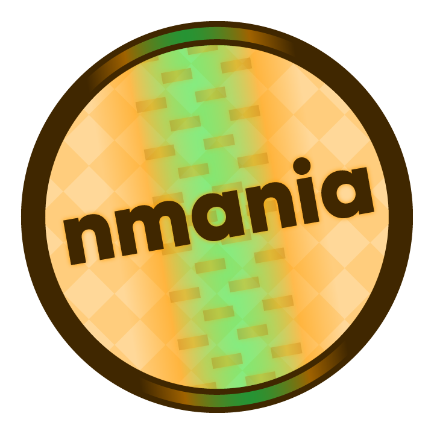
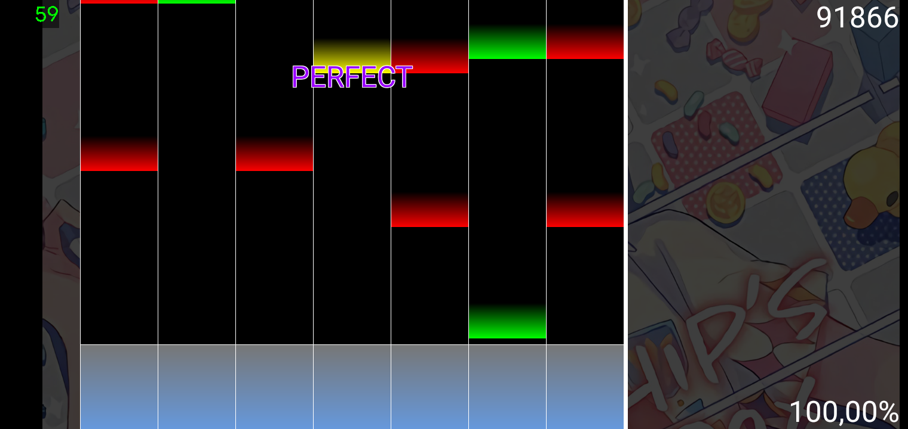

# nmania
Open source Vertical Scrolling Rhythm Game for J2ME. Compatible with osu!mania beatmaps and intended to be its clone.

## Project status

The project is partially abandoned. Feedback and bug reports are accepted. You can ask me for help via telegram or osu! chat.

## System requirements
### Minimal
- JVM/KVM on your device with CLDC 1.1
- MIDP 2.0/2.1 support
- JSR-75 (FC API), JSR-135 (MMAPI)
- Support of MPEG audio playback (it works better when audio is HWAed)
- At least 2 mb of RAM (this won't be enough, 8-12 is okay)
- Physical keyboard, or ability to connect one, or multitouch touchscreen
- Ability to handle at least 2 simultaneously held buttons (4+ will be okay) / at least 2 pointers (on touchscreen).
- Keyboard is always better than touchscreen, trust me. At least on nokia devices.
- Enough perfomance. In case of Symbian, ~450mhz CPU may be okay (f.e., OMAP 2430/31), but it depends on JVM implementation and CPU capatibilities. `9.3` devices work the best. Newer branches of Symbian JRT based on J9 are too slow.
### Recommended devices
Symbian 9.3 device with QWERTY keyboard is recommended (E5, E72).
Symbian ^3 devices like E6, E7, N8 have performance issues.
### Emulators
- `J2ME Loader`: playable. Use OTG or BT keyboard. 640x360 is recommended. Your working folder is likely `/storage/emulated/0/Data/Sounds/nmania/`. Use latest version possible.
- [`KEmulator nnmod`](https://nnp.nnchan.ru/kem/): playable. Use latest version possible.
- `PhoneME` is partially playable, has major problems with input/gameplay/music synchronization and files.
- `KEmulator` is not compatible due to broken multimedia API.
- `MahoLator` is not compatible due to lack of JSR-75.
- `MicroEmulator`: is not compatible due to lack of JSR-75.
- `FreeJ2ME-plus`: is not compatible due to lack of JSR-75.

## Join our chat in TG!
https://t.me/nnmidletschat

## How to play
Go to [osu!direct](https://osu.ppy.sh/beatmapsets/) or [it's mirror](https://beatconnect.io/) and download maps that you want to play (or copy them from stable's `Songs` folder). Extract your maps to `C:/Data/Sounds/nmania/` (if there is no such path, create folders manually) like stable does - one nested folder for each mapset.

**There is no guarantee that your beatmap will work as it is!** You may need to re-encode the music to MP3, rename weird files, etc. **osu!, osu!taiko and osu!catch beatmaps are not supported!** You need osu!mania-first beatmaps (for "mode" `3`).

If you have a standalone `nmania` beatmap, you need to compose a BMS yourself. Create a nested folder, place the beatmap file here. Find the music track and background image for it, put them in the same folder with the beatmap (keep eye on files' names, rename them if needed).

Launch the game and play. You may want to adjust scroll speed, dim and sound effects in _settings_, adjust look of the game in _skinning_.

If the game is too laggy even with flat skinning and without sounds, there is likely something wrong with your device, _WORKSFORME_.

Avoid playing with screen recording / streaming enabled or with BT headphones.

### Rich skinning structure
It's written inside the game. Please read "info" menu. Ask in issues for help if you didn't understand, I will attempt to clarify. You can also explore a [template](/info/richSkinTemplate.zip). Currently, we don't provide "osu!classic", "triangles" or "argon" skin out-of-the-box. Remake them for this game yourself if you need (and consider opening PR). OSK skins are not supported. Remake them if you need.

### Language setting
Localization support was dropped after UI rework.

### Flush rate troubles
Default HUD rendering requires 3 flushes in a game frame. This can limit FPS to 20 or even 16 on some devices. Try to enable `fullscreen flush`. Now there will be 1 flush in 1 frame, but yeah, the whole screen. Still bad? Disable HUD at all (`draw counters`) (don't forget to disable `fullscreen flush` too!). Now you will have 1 partial flush in 1 frame. This should be enough. Note: this won't help Nokia Belle devices.

## Ready binaries
### Stable
Look in [releases](https://github.com/Feodor0090/nmania/releases/latest). Use "obf" version if you don't know differences between them.

### Latest
On commit panel find green checkmark (if you see red cross, look in commit history for latest working), click it. Go to "summary" tab. Scroll down. Here are the latest builds.

## Manual build

### Linux
Run `build.sh`. **Note that it modifies source code! Do not forget to reset all changes using git after building!** Look for files in `./jar/` folder.

### Windows
We don't have build automatization for Windows. Install 1.6.0 jdk and latest WTK or your device's SDK. Look for further instructions in its documentation (you want to package a `MIDlet suite`).

### Mac OS / exotic *nix
You will have to deal with it by your own. Wine and J2ME toolkits for Windows may help you.

### IDE
This game was created using `Eclipse IDE for Java` with `Mobile Tools for Java` (`MTJ`) plugin for it. You also need J2SE 1.5 and an SDK for your device. Set up them to work together and create a JAR package from `Application Descriptor` screen.
